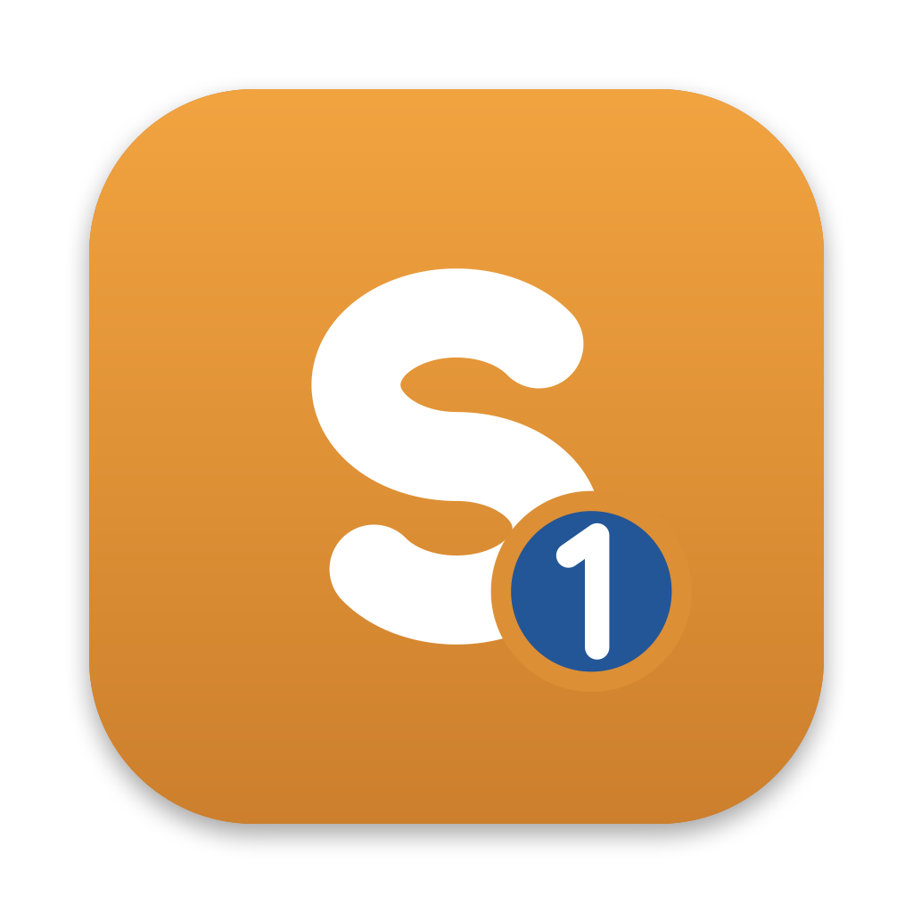
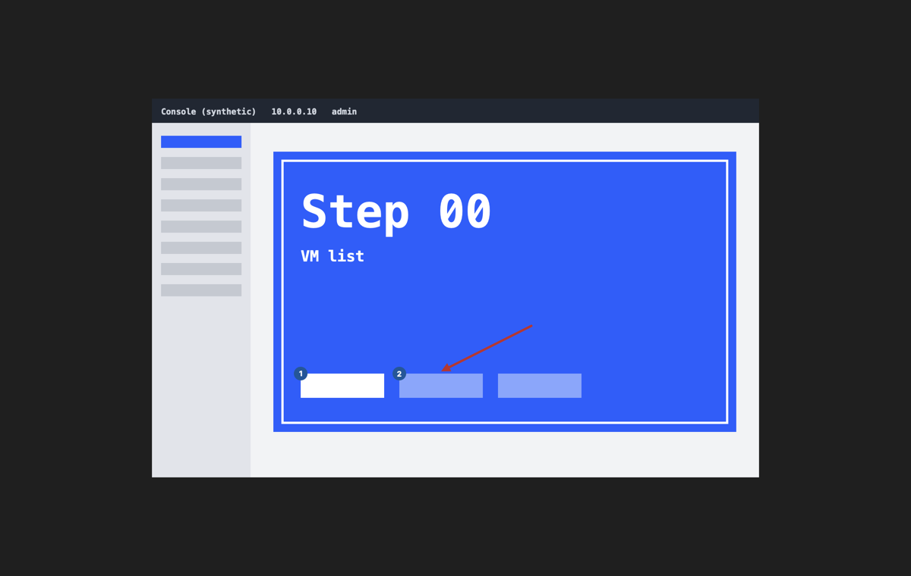
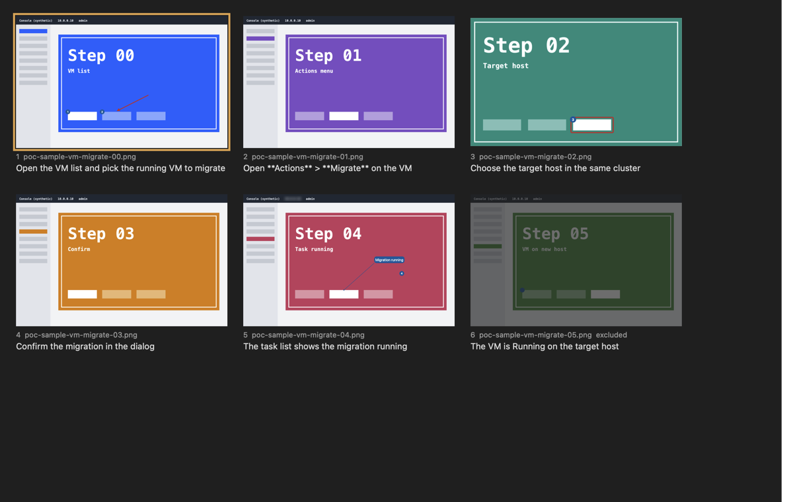

# sNotate

sNotate is a macOS-native image notation tool for PoC evidence folders: open a case folder of step screenshots, annotate them as one story with arrows, counters that continue across steps, text, highlights, blur and crop, and export one PNG per step into `notated/` while the originals stay untouched. Annotations live in a plain JSON sidecar beside the images and captions are the bullets of the case memo, so everything stays diffable in git. It is written in Swift with an AppKit canvas, uses only Apple frameworks and has no third-party dependencies

## Features

- One case per window: the folder `<case-id>/` with captures `<case-id>-<nn>.png`, the memo `<case-id>.md` and the sidecar `<case-id>.snotate.json`; the title says the case, the step and the file.
- Tools on single keys: arrow, rectangle, ellipse, counter, text with or without a pill and a leader, highlight and spotlight, blur and pixelate, crop; nine style presets from `~/.config/snotate/styles`; snapping to edges and centres.
- Counters number in story order across the whole case and can restart on any step; crops, blur and highlight regions stamp onto the following steps, the previous one or all.
- A storyboard of every step with its caption from the memo, edited in place; drag to reorder, drop or paste a capture to insert one, exclude a step, and a rename plan that numbers the files the way the evidence procedure does, applied only when you confirm it.
- Export: one PNG or JPEG per step at 0.5x, 1x or 2x, optionally with the caption burned in, a contact sheet as PNG or PDF, and a Typst fragment that includes every step in a Typst memo, and the captions as `<case-id>.md` in the evidence script's shape and `<case-id>.yaml`; a second export writes nothing that has not changed.
- Headless: `snotate --export <case or poc-root>` exports one case or every annotated case under a PoC root without opening a window.
- Never writes to the captures: annotations go to the sidecar (sorted keys, unknown keys kept), captions to one memo line at a time, output to `notated/`; `dd` moves a capture to the Trash, never deletes it. A failed save, a capture gone missing or a case folder that disappears is said in the window.
- Plain-text `config`, `keymap` and `styles` in `~/.config/snotate/`, applied the moment they change; `:set` changes one line, `:export-config` zips the folder.
- Fast: a 30-step case opens to the storyboard in under 200 ms, a drag frame takes 2 to 3 ms, and 30 annotated steps export in 0.6 s on an M-series Mac (bench/RESULTS.md).

## Part of sSuite

sSuite is a small family of macOS tools that turn work done on screen into step-by-step evidence and guides, one job per tool, published under the [uSuite](https://github.com/uSuite) organization. The organization page explains why the family exists.

| Tool | Job |
| --- | --- |
| [sCapture](https://github.com/uSuite/scapture) | captures a window at a fixed size and scale into the active case folder (shell proof of concept today, Swift app next) |
| [sView](https://github.com/uSuite/sview) | views images and walks case folders from the keyboard |
| **sNotate** (this one) | annotates a case folder as one story and exports one image per step |
| sWalk | planned: renders a notated case as an animated step-by-step clip |
| [scommon](https://github.com/uSuite/scommon) | the Swift package the tools share: folders, sorting, config and keymap |

sNotate is the editing link: it opens the case folders sCapture fills and shows new captures as steps the moment they land, and its `notated/` export is what you flip through in sView, paste into a report, and what sWalk will animate. It reads the same case memo sView shows.

## Keys

Press `?` in a window for your live keymap, and every command is in the menu bar with its keys; the full built-in list is in [docs/keys.md](docs/keys.md). The most used ones:

| Keys | Action |
| --- | --- |
| `j` `k` | next, previous step |
| `gg` `G` | first, last step |
| `]` `[` | next, previous case folder |
| `cmd-1` `cmd-2` | step view, storyboard |
| `v` `a` `r` `e` `n` `t` `h` `b` `c` | select, arrow, rectangle, ellipse, counter, text, highlight, blur, crop |
| `1` to `9` | style preset |
| `gt` `lt` | stamp onto the following steps, the previous step |
| `x` | exclude the step |
| `dd` | remove the step: capture to the Trash, memo block out (`cmd-z` puts it back) |
| `=` `0` `+` `-` `z` | fit, actual size, zoom in, out, to an area |
| `cmd-e` `cmd-E` `cmd-C` | export the case, the step, copy the step as exported |
| `:` | command line: a step number, or any command |
| `cmd-z` `cmd-Z` | undo, redo |
| `cmd-,` | Settings: snap, config import and export, presets with a preview |
| `?` | the keys |

## Install

Requires macOS 26 or newer. No release is published yet, so build it with Xcode 26 and XcodeGen (`brew install xcodegen`): `make app` writes `build/sNotate.app`, and `make install` links the `snotate` command into `~/.local/bin`. SwiftPM fetches scommon from GitHub on the first build, or uses a `../scommon` checkout beside this one. Release zips are signed ad hoc until there is a Developer ID, so macOS blocks the first open; allow it under System Settings, Privacy and Security.

`snotate <case-folder or capture>...` opens cases, `ls -d poc-*/ | snotate -` reads them from stdin, and `snotate --export <case or poc-root>` exports without a window.

## Development

macOS 26 and Xcode 26 (Swift 6.2). `make test` runs the core tests, `make app` builds the app, `make smoke` drives it through scripted runs with snapshots in `build/smoke/`, `make hostile` opens hostile fixtures, `make bench` and `make idle` check the performance targets, `make golden` regenerates the rendering goldens, `make cheatsheet` writes docs/keys.md, and `make release` builds a universal app and zip. The design lives in [docs/02-tech-stack.md](docs/02-tech-stack.md), the decisions in [docs/DECISIONS.md](docs/DECISIONS.md) and the work items in [docs/01-backlog.md](docs/01-backlog.md).

## Licence

MIT, see [LICENSE](LICENSE).
