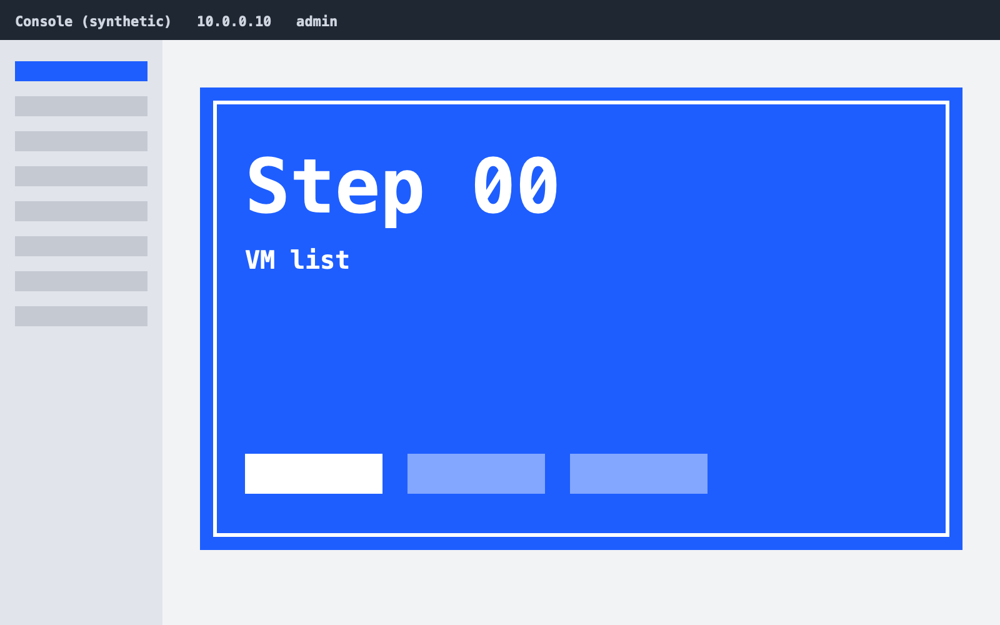
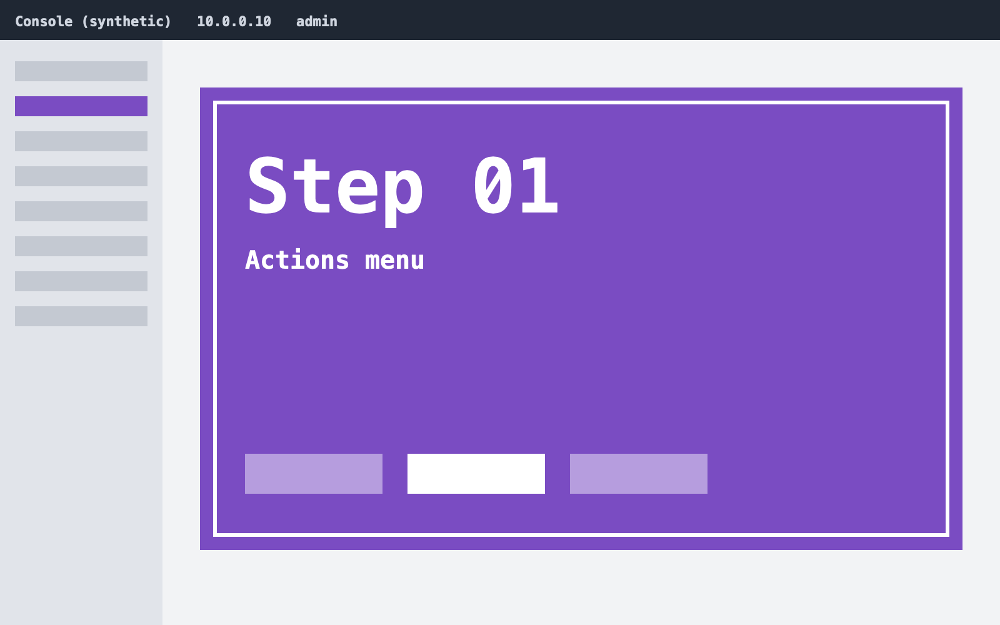
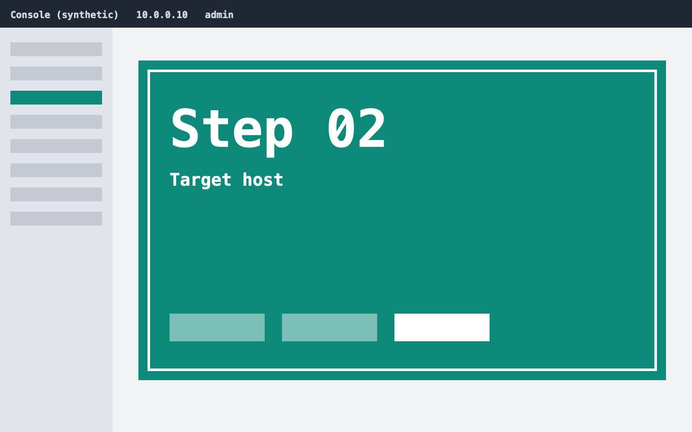
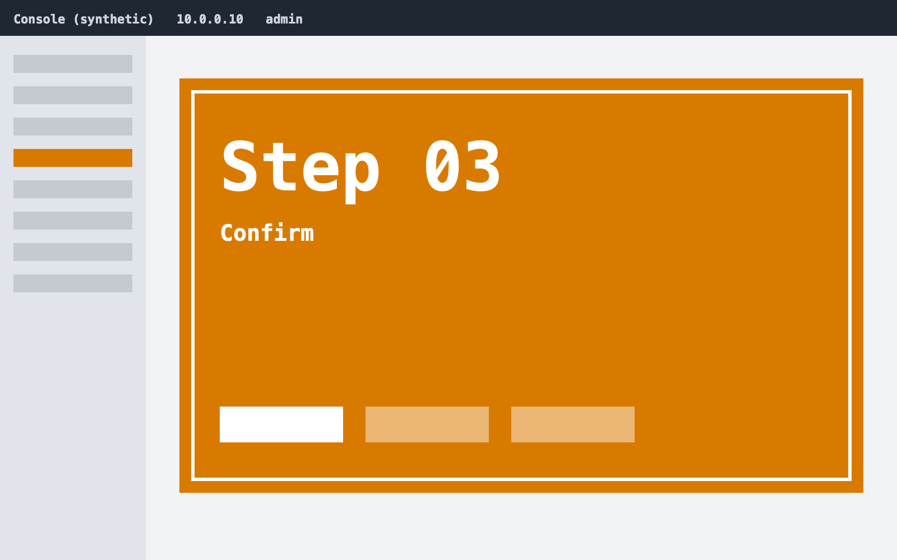
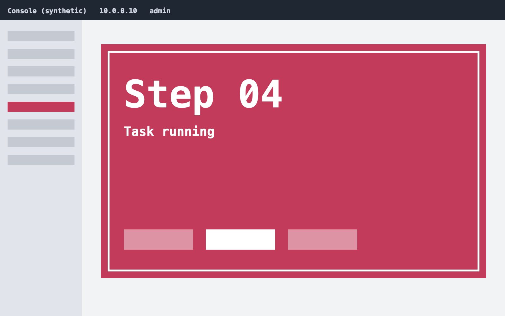
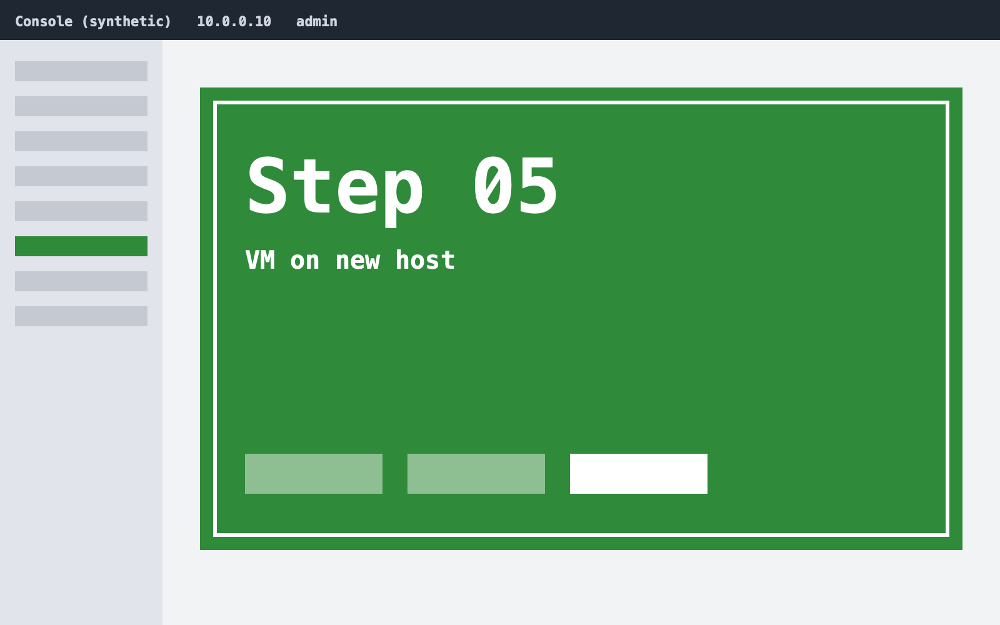

# poc-sample-vm-migrate

- Open the VM list and pick the running VM to migrate

- Open **Actions** > **Migrate** on the VM

- Choose the target host in the same cluster

- Confirm the migration in the dialog

- The task list shows the migration running

- The VM is Running on the target host

