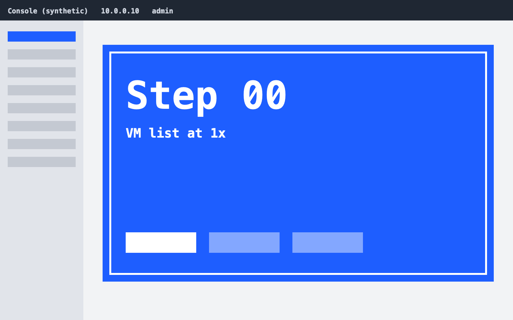
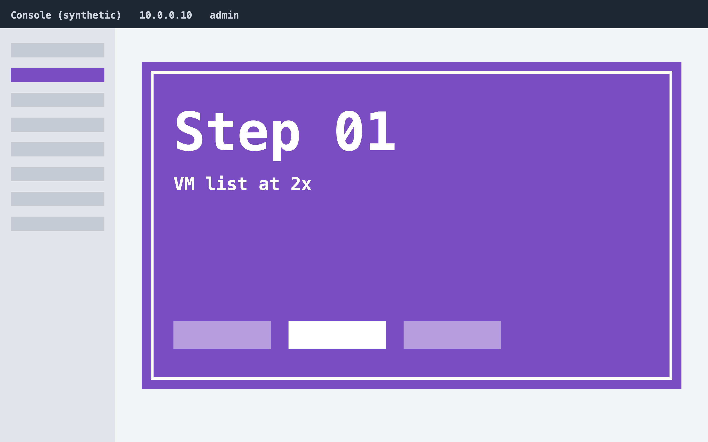
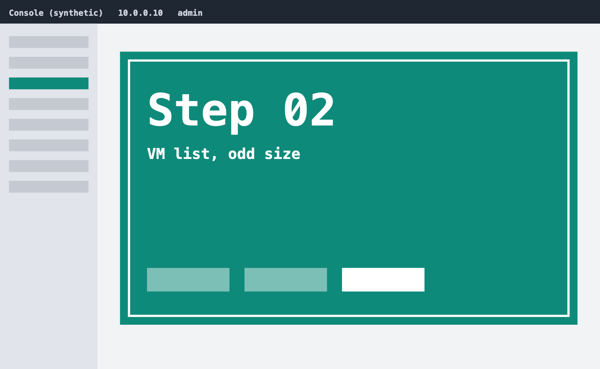

# poc-sample-vm-scale

- The console captured at 1x, 1600 x 1000

- The same console captured at 2x, 3200 x 2000: an exact multiple, annotations scale

- The same console at 1592 x 982: not a multiple, the step is flagged

